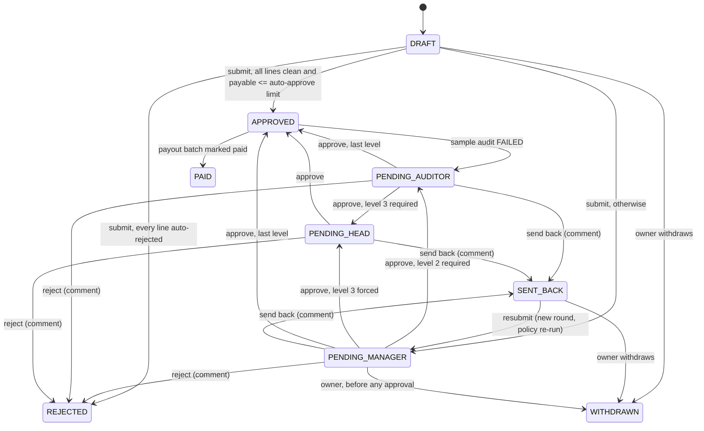

# 13 Domain Design: ExpenseFlow (as built)

> The ARD is authoritative (ADR-0011). This doc shows how the code implements it, where each rule is enforced and which test proves it.
> Differences and open gaps: `docs/14-ard-alignment.md`.

## Context and containers
```
 Employee / Manager / Auditor / Finance head (browser, phone or desktop)
            | HTTPS (same origin)
            v
 +------------------------+   /api/* rewrite   +---------------------------------------------+
 | Next.js frontend :3000 | -----------------> | FastAPI backend :8000 (modular monolith)    |
 | renders the API; no    |  server components |  auth org policy receipts claims approvals  |
 | business rules         | -----------------> |  payouts reports audit health               |
 +------------------------+  BACKEND_INTERNAL  +------------------+--------------+-----------+
                                                                   |              |
                                                      SQLite (WAL, 21 tables)   receipt files (random keys, SHA-256)
                                                                   |
                                       payout CSV (mock bank file) -> head downloads it; nothing automated leaves the system
```
Layering: router (HTTP) -> deps -> service (rules, transaction, audit write) -> repository (SQL) -> models. The `policy` engine is pure (no DB, no clock). Enforced by `import-linter` (13 contracts).

## Backend modules
| Module | Tables | Public interface | Notes |
|---|---|---|---|
| `org` | departments, cities, categories, users, bank_accounts | `OrgService` (`person`, `subordinate_ids`, `ancestors`, `bank_details`, `me`, admin) | acyclic hierarchy, `permissions_for(role)` |
| `auth` | - | login / refresh / logout | cookie JWT + CSRF, lockout after 5 failures, failed logins audited |
| `audit` | audit_events | `AuditService.record`, `verify_chain` | append-only, SHA-256 hash chain |
| `policy` | policy_versions, policy_rules, approval_levels, app_config | `PolicyService` (`snapshot`, `publish`, ...), pure `evaluate()` | rules as data, versions immutable once published |
| `receipts` | receipts | `ReceiptService.upload` / `info` / `stored` | magic-byte check, 5 MB bounded read, storage interface |
| `claims` | claims, claim_lines, line_findings, approval_steps, claim_comments, delegations, sample_audits, claim_transitions | `ClaimsService` (capture, submit, chain, delegation, samples, visibility, read models) | the workflow engine |
| `approvals` | - | HTTP API over `ClaimsService` (inbox, step actions, review queue, bulk approve, sample audits, delegations) | thin by design |
| `payouts` | payout_batches, payout_items | `PayoutService` | maker-checker, ARD CSV |
| `reports` | - | `ReportsService.summary` | one endpoint, role-scoped |
| `health` | - | live / ready / version, `/healthz`, `/readyz` | |

## Claim state machine (ARD section 4)

The 23 allowed pairs live in `claims/state.py` and are seeded into `claim_transitions`, where a DB trigger rejects any other `status` update and any insert that is not `DRAFT`. The diagram omits two pairs for readability: `SENT_BACK -> APPROVED` and `SENT_BACK -> REJECTED`, which exist because a resubmit re-runs the policy and can be auto-approved or auto-rejected (ARD transition 13, "or as in rows 1 to 2").

## Policy as configuration
Rule **types** are code (`policy/engine.py`: daily cap, per-unit cap by tier, per-line cap, receipt required, duplicate, weekend, split window, max age). Rule **instances**, thresholds and scalar settings are database rows. `evaluate(lines, context, snapshot)` is pure; the claims service prepares the read-only context (earlier daily totals, duplicate keys and hashes, recent own lines) from the repository. Every submitted line stores its findings and the claim stores `policy_version_id`, so any decision can be replayed. Rule tests are table-driven from `app/seeds/rule_fixtures.json` (35 cases including boundaries at, just below and just above each limit), written before the engine and shared with the seed.

## Data model (21 tables)
`departments, cities, categories, users, bank_accounts` | `policy_versions, policy_rules, approval_levels, app_config` | `receipts` | `claims, claim_lines, line_findings, approval_steps, claim_comments, delegations, sample_audits, claim_transitions` | `payout_batches, payout_items` | `audit_events`.

Database constraints in addition to the application checks: CHECK on every status, role and outcome and on `amount_paise > 0`; unique `payout_items.claim_id`; `verified_by_id <> created_by_id`; one PENDING step per (claim, round, level); one ACTIVE policy version; the transition trigger; frozen published rules (trigger); `audit_events` UPDATE and DELETE blocked (trigger).

## Bypass threat model (ARD section 11): control, layer, proof
| ID | Bypass | Control | Layer | Proof |
|---|---|---|---|---|
| C1 | Split one spend into small claims | `SPLIT_SUSPECT` (3-day window, same vendor or category) forces the auditor | policy | rule fixtures "split claim ..." |
| C2 | Edit after approval | Lines editable only in DRAFT/SENT_BACK; resubmit starts a new round | service, DB trigger | `test_c2_lines_cannot_change_after_submit`, DB rules test |
| C3 | Self-approval or colluding hierarchy | Claimant never acts on own claim; chain from the hierarchy; acyclic on every manager change | service | `test_c3_head_cannot_approve_own_claim`, `test_admin_users_create_update_and_reject_cycles` |
| C4 | Delegation abuse | same-or-higher role, not the claimant, at most 30 days, one active per level, both identities audited | service | `test_delegation_rules_c4` |
| C5 | Skip a level | Only the open step is actionable (409/403); unique open-step index | service, DB | `test_c5_cannot_act_on_a_step_that_is_not_yours` |
| C6 | Duplicate evasion | Vendor normalisation and receipt SHA-256 across all employees | policy | fixtures, `test_e2e08_...` |
| C7 | Pay without a second pair of eyes | creator != verifier; export only from VERIFIED; file hashed and frozen; unique payout item | service, DB | `test_e2e09_batch_verify_export_mark_paid` |
| C8 | Policy tampering | Immutable published versions, head only, audited with before/after | service, DB trigger | `test_c8_policy_versions_publish_and_freeze` |
| C9 | Audit tampering | No update/delete path; triggers; hash-chain verifier | DB, service | DB rules test, `test_audit_chain_is_valid_...` |
| C10 | Bulk approve as a rubber stamp | auditor level only, max 50, skips duplicates, high severity and changed claims; audit event per claim | service, API | `test_e2e08_...` |
| C11 | Dodge the sample audit | CSPRNG draw in the approval transaction, draw and rate audited, hidden from the employee, payout hold | service | `test_c11_sample_audit_holds_payout_and_failure_reopens` |
| C12 | Race or double click | conditional `UPDATE ... WHERE version=?`, 409 `CLAIM_VERSION_CONFLICT` | service, DB | `test_c12_stale_version_is_a_409` |
| C13 | IDOR | 404 for not-yours; receipts served only through the authorised endpoint | service | `test_e2e10_...` |
| C14 | Odd dates | future dates rejected (`FUTURE_EXPENSE_DATE`); `CLAIM_AGE_LIMIT` seeded inactive | service, policy | age rule: fixture; future date: **test pending (AI-014)** |

## Mock bank file
UTF-8, LF, one file per batch named `EXPFLOW_<batch_no>_<YYYYMMDD>.csv`: a column header row, an `H` row, one `D` row per claim and a `T` trailer (`COUNT=n`, exact sum). Amounts come from integer paise (no floats); payment mode is IMPS up to 2,00,000 INR, otherwise NEFT (config); narration is limited to 30 characters of letters, digits and spaces; cells starting with `=`, `+`, `-` or `@` are prefixed with a single quote; generation is deterministic and the stored file is re-hashed on every download.
