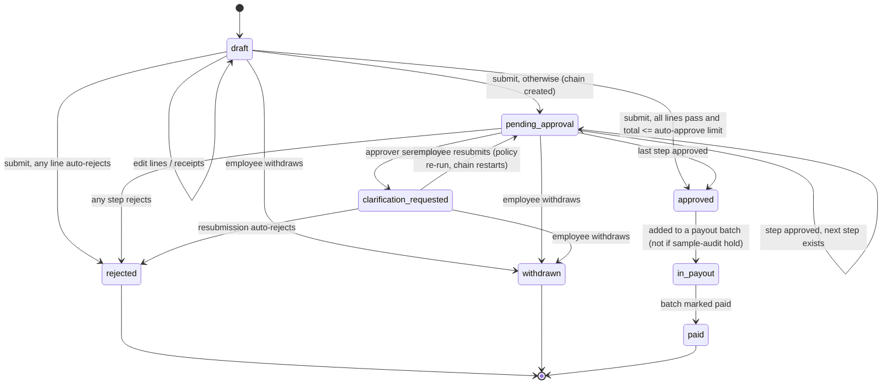

# 13 Domain Design: ExpenseFlow

> **Superseded by the ARD (ADR-0011).** Kept for history; the ARD sections 3-11 are authoritative and
> `docs/14-ard-alignment.md` lists the differences.

## Context and containers
```
 Employee / Manager / Auditor / Finance head (browser, phone or desktop)
            |
            | HTTPS (same origin)
            v
 +------------------------+   /api/* rewrite   +-------------------------------------------+
 | Next.js frontend :3000 | -----------------> | FastAPI backend :8000                      |
 | claims, approvals,     |                    |  auth  org  policy  claims  receipts       |
 | audit queue, payouts,  |  server components |  approvals  payouts  reports  audit        |
 | dashboard              | -----------------> |  (modular monolith, service-only calls)    |
 +------------------------+  BACKEND_INTERNAL  +---------------------+---------------------+
                                                      |                     |
                                              SQLite (WAL, volume)   receipts/ (files by SHA-256, volume)
                                                      |
                                       payout CSV download (mock bank file) -> finance head -> bank (out of scope)
```

## Backend modules and dependencies
| Module | Owns (tables) | Calls (services only) |
|---|---|---|
| `org` | departments, users (role, manager, bank details) | - |
| `auth` | (none; JWT cookies, ADR-0006) | org |
| `audit` | audit_events (append-only) | - |
| `policy` | policy_versions (JSON config, immutable versions) | - |
| `receipts` | receipts (sha256, mime, size, path) | audit |
| `claims` | claims, claim_lines, line_flags, claim_comments | org, policy, receipts, audit |
| `approvals` | approval_steps, delegations | org, claims, audit |
| `payouts` | payout_batches, payout_items | claims, org, audit |
| `reports` | (read models over claims/approvals) | claims, approvals |

Rule: `policy` is pure. `PolicyEngine.evaluate(claim, history, config) -> Evaluation` has no I/O, so every rule is unit-tested without a database (tests are written before the engine).

## Claim state machine

- Transitions live in one table in `claims/state.py`; any other transition raises `ConflictError(code="invalid_transition")`.
- Only `draft` and `clarification_requested` claims are editable, and only by their owner.
- `approved` claims with `audit_sample_status = pending` cannot enter a payout batch (Assumption A-6).

## Policy as configuration (ADR-0010)
Policy versions are JSON documents in `policy_versions` (immutable, one `active`). Version 1 is seeded from `backend/app/seeds/policy_v1.json`. A claim stores the `policy_version_id` used at its last submission, and every flag stores the rule id, so decisions are reproducible.
```json
{
  "currency": "INR",
  "auto_approve_max_total_paise": 500000,
  "sample_audit_rate": 0.10,
  "approval_thresholds_paise": {"finance_auditor": 2500000, "finance_head": 10000000},
  "tier1_cities": ["Mumbai", "Delhi", "Bengaluru", "Chennai", "Kolkata", "Hyderabad", "Pune", "Ahmedabad"],
  "rules": [
    {"id": "meal_daily_limit", "type": "daily_category_limit", "category": "meal", "limit_paise": 150000, "outcome": "route"},
    {"id": "hotel_nightly_limit", "type": "tiered_category_limit", "category": "hotel", "tier1_limit_paise": 600000, "other_limit_paise": 400000, "outcome": "route"},
    {"id": "cab_trip_limit", "type": "per_line_category_limit", "category": "local_cab", "limit_paise": 200000, "outcome": "route"},
    {"id": "receipt_required", "type": "receipt_required_above", "threshold_paise": 50000, "outcome": "reject"},
    {"id": "duplicate", "type": "duplicate_detection", "outcome": "route"},
    {"id": "weekend_spend", "type": "weekend_flag", "outcome": "route"},
    {"id": "stale_expense", "type": "stale_expense", "max_age_days": 90, "outcome": "route"}
  ]
}
```
Rule `type`s are implemented in code (a registry of small functions); their parameters, outcomes and on/off live in config. Evaluation: per line, collect flags; a line's outcome is the most severe of its flags (`reject` > `route` > `approve`); the claim outcome follows A-1 to A-3.

## Approval chain (ADR-0009)
At submission (outcome `route`), the chain is **materialised** as ordered `approval_steps` rows: `manager` (assignee = claimant's manager), `finance_auditor` (role pool) if total > 25,000 INR, `finance_head` (role pool) if total > 1,00,000 INR. Only the lowest pending step is actionable. A user may act on a step if they are the assignee, a member of the step's role pool, or the active delegate of the assignee (`delegations` with a date range). Every action records `acted_by` and `on_behalf_of`. Send-back cancels the remaining steps; resubmission creates a fresh chain.

## Data model (main tables)
```
departments(id, name, code)
users(id, email, full_name, employee_code, role[employee|finance_auditor|finance_head], department_id, manager_id -> users, password_hash, bank_account, ifsc, is_active)
policy_versions(id, version, document JSON, is_active, created_by, created_at)
claims(id, number, owner_id, title, status, total_paise, policy_version_id, policy_outcome, submitted_at, decided_at, audit_sample_status[none|pending|cleared|issue], payout_batch_id, version)
claim_lines(id, claim_id, category[meal|hotel|local_cab|travel|other], description, vendor, amount_paise, expense_date, city, receipt_id, outcome)
line_flags(id, line_id, rule_id, outcome, message)
receipts(id, owner_id, sha256, content_type, size_bytes, storage_key, original_name)
approval_steps(id, claim_id, round, sequence, kind[manager|finance_auditor|finance_head], assignee_id, status[pending|approved|rejected|sent_back|cancelled], acted_by_id, on_behalf_of_id, comment, acted_at)
delegations(id, delegator_id, delegate_id, starts_on, ends_on, revoked_at)
claim_comments(id, claim_id, author_id, body, created_at)
payout_batches(id, number, status[draft|exported|paid], total_paise, claim_count, exported_at, paid_at, created_by)
audit_events(id, occurred_at, actor_id, on_behalf_of_id, action, entity_type, entity_id, data JSON, request_id)   -- UPDATE/DELETE blocked by triggers
```

## Mock bank file (payout CSV)
```
H,EXPENSEFLOW,<batch_number>,<YYYYMMDD>,<count>,<total_rupees.paise>
D,<seq>,<employee_code>,<beneficiary_name>,<bank_account>,<ifsc>,<amount_rupees.paise>,<claim_number>
...
T,<count>,<total_rupees.paise>
```
UTF-8, comma separated, no quoting except names containing commas (RFC 4180), CRLF line endings. Header and trailer totals must equal the sum of `D` lines.

## Skeptical finance-auditor review: ways to bypass approvals, and the control for each
| # | Bypass attempt | Control |
|---|---|---|
| 1 | Split one expense into several small claims to stay under thresholds / auto-approve limit | Meal limit is per day across all claims; duplicate detection on vendor+amount+date; dashboard shows per-employee daily totals; thresholds use claim total, and auditor sample hits auto-approved claims |
| 2 | Approve your own claim (or via your own delegate) | Service rule: actor/on-behalf-of must differ from claimant; delegation to or from claimant blocked for their own claims |
| 3 | Manager also holds auditor/head role and approves two steps | One person may act on at most one step per claim |
| 4 | Edit a claim after approval (raise amounts) | Lines editable only in `draft`/`clarification_requested`; resubmission re-runs policy and restarts the chain; optimistic `version` on claims |
| 5 | Re-use the same receipt image on a new claim | Receipt SHA-256 duplicate flag across all earlier lines |
| 6 | Change the policy to approve your claim | Policy changes only by finance head, create a new immutable version, are audited; claims keep the version they were evaluated with |
| 7 | Tamper with or delete the audit trail | No update/delete code path; DB triggers abort UPDATE/DELETE on `audit_events` |
| 8 | Call the API directly to skip UI checks (e.g. approve a step not yet active, jump status) | All rules in services; explicit state-transition table; only the lowest pending step is actionable |
| 9 | Delegate to a colleague to rubber-stamp | Delegations are time-boxed, audited, visible on the claim; delegate cannot be the claimant |
| 10 | Pay a claim twice | Claim can be in at most one batch (`payout_batch_id`); batch immutable after export; `paid` is terminal |
| 11 | Bulk approve hides bad claims | Bulk approve runs the same per-claim checks and returns per-claim results; flagged claims are listed first |
| 12 | Backdate expenses to old periods | Expense date cannot be in the future; dates older than 90 days are flagged (`stale_expense`, configurable) |
| 13 | Upload a non-receipt file / malware | Magic-byte type check (PDF/JPEG/PNG only), 5 MB limit enforced while reading, content-addressed storage (no user-controlled paths); files served inline for the viewer with `nosniff` and `Content-Security-Policy: sandbox` |
